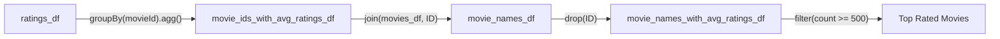
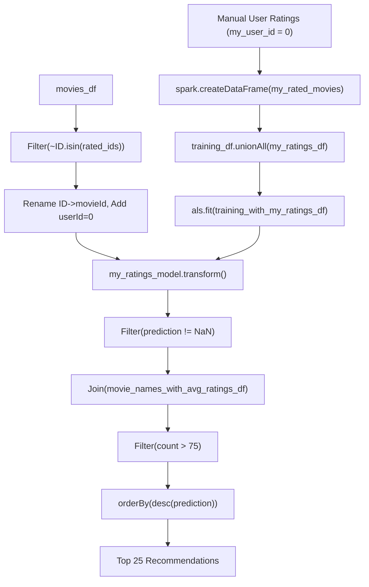

# Cheat Sheet: PD4 - Movie Rating & Collaborative Filtering with Alternating Least Squares (ALS)

Reference guide covering recommender systems in Apache Spark ML: dataset preprocessing, matrix factorization theory, ALS hyperparameter tuning, handling cold-start and NaN values (SPARK-14489), model evaluation against naive baselines, and generating personalized Top-N recommendations.

---

## 1. Setup & Native Acceleration (OpenBLAS / LAPACK)

ALS matrix factorization involves intensive linear algebra operations. Running ALS without optimized native BLAS/LAPACK binaries forces the JVM into slow generic software routines.

### Installing Acceleration Libraries (Debian / Ubuntu)
```bash
sudo apt-get update
sudo apt-get install -y libopenblas-dev liblapack-dev
```

### Spark JVM Configuration
Before initializing the Spark context, point the driver and executors to the native shared library directory:

```python
import os
import findspark
findspark.init()

# Path to installed OpenBLAS shared objects
OPENBLAS_LIB_DIR = "/usr/lib/x86_64-linux-gnu"

os.environ["SPARK_DRIVER_EXTRAJAVAOPTIONS"] = f"-Djava.library.path={OPENBLAS_LIB_DIR}"
os.environ["SPARK_EXECUTOR_EXTRAJAVAOPTIONS"] = f"-Djava.library.path={OPENBLAS_LIB_DIR}"
os.environ["HADOOP_CONF_DIR"] = "/opt/hadoop/etc/hadoop/conf"

import pyspark
from pyspark.sql import SparkSession
from pyspark.sql import functions as F
from pyspark.sql.types import StructType, StructField, IntegerType, DoubleType, StringType

spark = SparkSession.builder \
    .master("local[*]") \
    .appName("Predicting Movie Ratings Application") \
    .getOrCreate()
```

---

## 2. Data Ingestion, Explicit Schemas & In-Memory Caching

Inferring schema across 20+ million rows forces Spark to execute an extra full read pass over the CSV files. Explicit schemas eliminate this overhead.

```python
# Schema definition for MovieLens ratings
ratings_df_schema = StructType([
    StructField('userId', IntegerType(), True),
    StructField('movieId', IntegerType(), True),
    StructField('rating', DoubleType(), True),
    StructField('Timestamp', IntegerType(), True)
])

# Schema definition for MovieLens movies
movies_df_schema = StructType([
    StructField('movieId', IntegerType(), True),
    StructField('title', StringType(), True),
    StructField('Genres', StringType(), True)
])

# Read from HDFS or local filesystem
raw_ratings_df = spark.read.csv('/ml-20m/ratings.csv', schema=ratings_df_schema, header=True)
ratings_df = raw_ratings_df.drop('Timestamp')

raw_movies_df = spark.read.csv('/ml-20m/movies.csv', schema=movies_df_schema, header=True)
movies_df = raw_movies_df.drop('Genres').withColumnRenamed('movieId', 'ID')

# Persist DataFrames in memory to avoid repeated HDFS disk I/O
ratings_df.cache()
movies_df.cache()
```

---

## 3. Basic Recommendations (Descriptive Statistics)

A non-personalized baseline recommends items with the highest global average rating, constrained by a minimum review count threshold to eliminate sample-size bias.



### Computing Average Ratings & Joining Metadata
```python
# Group by movie, calculate count and average rating
movie_ids_with_avg_ratings_df = ratings_df.groupBy('movieId').agg(
    F.count(ratings_df.rating).alias("count"),
    F.avg(ratings_df.rating).alias("average")
)

# Join movie titles and drop redundant join keys
movie_names_df = movie_ids_with_avg_ratings_df.join(
    movies_df,
    movie_ids_with_avg_ratings_df.movieId == movies_df.ID,
    how='inner'
)
movie_names_with_avg_ratings_df = movie_names_df.drop('ID')

# Filter movies with at least 500 reviews to avoid extreme low-count averages
movies_with_500_ratings_or_more = movie_names_with_avg_ratings_df.filter(
    movie_names_with_avg_ratings_df['count'] >= 500
)

# Display top 20 movies sorted by rating descending
movies_with_500_ratings_or_more.orderBy(F.desc('average')).show(20, truncate=False)
```

---

## 4. Collaborative Filtering & Alternating Least Squares (ALS)

### Mathematical Formulation
Let $R \in \mathbb{R}^{m \times n}$ be the sparse user-item rating matrix ($m$ users, $n$ movies). Most entries $R_{u, i}$ are unobserved.

Matrix factorization approximates $R$ as the product of two lower-rank dense matrices:
$$R \approx U V^T$$
where:
- $U \in \mathbb{R}^{m \times k}$: User latent factor matrix.
- $V \in \mathbb{R}^{n \times k}$: Item latent factor matrix.
- $k$: Rank (number of latent dimensions / features).

The objective function minimizes regularized squared error over observed ratings $\Omega$:
$$\min_{U, V} \sum_{(u, i) \in \Omega} \left( R_{u, i} - u_u^T v_i \right)^2 + \lambda \left( \sum_u \|u_u\|_2^2 + \sum_i \|v_i\|_2^2 \right)$$

### Alternating Optimization
Because simultaneous optimization of $U$ and $V$ is non-convex:
1. **Fix $V$**: The problem decouples into independent Ridge Regression problems for each user $u_u$.
2. **Fix $U$**: The problem decouples into independent Ridge Regression problems for each item $v_i$.
3. Repeat alternating updates for `maxIter` iterations until convergence.

---

## 5. Dataset Splitting & Deterministic Seeds

To train, tune, and test collaborative filtering models without data leakage, split the ratings into three disjoint sets:

```python
seed = 1800009193

# Split: 60% Training, 20% Validation, 20% Test
(split_60_df, split_a_20_df, split_b_20_df) = ratings_df.randomSplit([0.6, 0.2, 0.2], seed=seed)

training_df = split_60_df.cache()
validation_df = split_a_20_df.cache()
test_df = split_b_20_df.cache()
```

---

## 6. ALS Configuration & Manual Hyperparameter Search

### Spark Issue SPARK-14489 & NaN Handling
In collaborative filtering, validation or test partitions often contain users or items absent from training folds. Standard Spark ALS produces `NaN` predictions for unseen pairs. When standard `CrossValidator` evaluates these `NaN` values, RMSE returns `NaN`, invalidating the grid search.

**Solution**: Execute a manual loop over hyperparameter candidates and filter out `NaN` values before passing predictions to `RegressionEvaluator`.

```python
from pyspark.ml.recommendation import ALS
from pyspark.ml.evaluation import RegressionEvaluator

# Initialize ALS estimator
als = ALS()
als.setMaxIter(5) \
   .setSeed(seed) \
   .setRegParam(0.1) \
   .setUserCol("userId") \
   .setItemCol("movieId") \
   .setRatingCol("rating")

# Initialize RMSE evaluator
reg_eval = RegressionEvaluator(
    predictionCol="prediction",
    labelCol="rating",
    metricName="rmse"
)

ranks = [4, 8, 12]
errors = [0, 0, 0]
models = [0, 0, 0]
min_error = float('inf')
best_rank_idx = -1

# Grid search over rank parameter
for idx, rank in enumerate(ranks):
    als.setRank(rank)
    model = als.fit(training_df)
    
    # Predict on validation data
    predict_df = model.transform(validation_df)
    
    # Filter out NaNs resulting from cold-start items/users
    predicted_ratings_df = predict_df.filter(predict_df.prediction != float('nan'))
    
    # Compute validation RMSE
    error = reg_eval.evaluate(predicted_ratings_df)
    errors[idx] = error
    models[idx] = model
    
    print(f"Rank {rank} -> Validation RMSE: {error:.4f}")
    if error < min_error:
        min_error = error
        best_rank_idx = idx

# Select best model
best_rank = ranks[best_rank_idx]
als.setRank(best_rank)
my_model = models[best_rank_idx]
print(f"Selected Best Rank: {best_rank} with RMSE: {min_error:.4f}")
```

---

## 7. Model Evaluation & Comparison Against Baseline

### Evaluating Best Model on Test Dataset
```python
# Predict on held-out test data
predict_df = my_model.transform(test_df)
predicted_test_df = predict_df.filter(predict_df.prediction != float('nan'))

# Calculate test RMSE
test_RMSE = reg_eval.evaluate(predicted_test_df)
print(f"ALS Model Test RMSE: {test_RMSE:.4f}")
```

### Computing Naive Baseline (Global Training Mean)
To verify that collaborative filtering adds predictive value beyond simple popularity/mean guessing, compare against a model that predicts the global average rating for all pairs:

```python
# Compute scalar average rating across training set
avg_rating_df = training_df.select(F.avg('rating'))
training_avg_rating = avg_rating_df.collect()[0][0]

# Generate baseline prediction column using F.lit()
test_for_avg_df = test_df.withColumn('prediction', F.lit(training_avg_rating))

# Evaluate baseline RMSE
test_avg_RMSE = reg_eval.evaluate(test_for_avg_df)
print(f"Global Average Test RMSE: {test_avg_RMSE:.4f}")
```

### Interpretation of Results
| Model | Test RMSE | Description |
| :--- | :--- | :--- |
| **Global Mean Baseline** | $\approx 1.0517$ | Unpersonalized constant prediction ($\mu \approx 3.53$) |
| **ALS Model ($k=8$)** | $\approx 0.8096$ | Personalized matrix factorization |

The ALS model achieves an error reduction of over $23\%$, confirming effective extraction of user preference structures.

---

## 8. Personalized Recommendations Workflow



### Step 1: Create Personal Rating Profile
```python
from pyspark.sql import Row

my_user_id = 0

# (userId, movieId, rating)
my_rated_movies = [
    (my_user_id, 318, 5.0),   # Shawshank Redemption, The (1994)
    (my_user_id, 858, 5.0),   # Godfather, The (1972)
    (my_user_id, 50, 4.5),    # Usual Suspects, The (1995)
    (my_user_id, 527, 5.0),   # Schindler's List (1993)
    (my_user_id, 1221, 4.5),  # Godfather: Part II, The (1974)
    (my_user_id, 1193, 4.0),  # One Flew Over the Cuckoo's Nest (1975)
    (my_user_id, 2959, 5.0),  # Fight Club (1999)
    (my_user_id, 260, 4.5),   # Star Wars: Episode IV - A New Hope (1977)
    (my_user_id, 296, 5.0),   # Pulp Fiction (1994)
    (my_user_id, 2571, 4.5),  # Matrix, The (1999)
    (my_user_id, 356, 4.0),   # Forrest Gump (1994)
]

my_ratings_df = spark.createDataFrame(my_rated_movies, ['userId', 'movieId', 'rating'])
```

### Step 2: Merge with Training Data & Retrain Model
```python
# Concat personal ratings to training partition
training_with_my_ratings_df = training_df.unionAll(my_ratings_df)

# Reset ALS parameters with optimal settings
als.setPredictionCol("prediction") \
   .setMaxIter(5) \
   .setSeed(seed) \
   .setRank(best_rank) \
   .setRegParam(0.1) \
   .setUserCol("userId") \
   .setItemCol("movieId") \
   .setRatingCol("rating")

# Retrain model incorporating personal preferences
my_ratings_model = als.fit(training_with_my_ratings_df)
```

### Step 3: Identify Candidate Unrated Movies
```python
# Extract IDs of movies already rated
my_rated_movie_ids = [x[1] for x in my_rated_movies]

# Exclude already-rated movies using ~ (bitwise NOT) and isin()
not_rated_df = movies_df.filter(~movies_df['ID'].isin(my_rated_movie_ids))

# Prepare unrated DataFrame matching ALS schema expectations
my_unrated_movies_df = not_rated_df \
    .withColumnRenamed('ID', 'movieId') \
    .withColumn('userId', F.lit(my_user_id))

# Generate predictions for all candidate movies
raw_predicted_ratings_df = my_ratings_model.transform(my_unrated_movies_df)
predicted_ratings_df = raw_predicted_ratings_df.filter(
    raw_predicted_ratings_df['prediction'] != float('nan')
)
```

### Step 4: Quality Filtering & Top-25 Ranking
```python
# Join predictions with metadata and global review counts
predicted_with_counts_df = predicted_ratings_df.join(
    movie_names_with_avg_ratings_df,
    on='movieId'
)

# Filter out low-sample movies (count > 75) and sort by predicted score descending
predicted_highest_rated_movies_df = predicted_with_counts_df \
    .filter(predicted_with_counts_df['count'] > 75) \
    .orderBy(F.desc('prediction'))

print("Top 25 Personalized Movie Recommendations:")
predicted_highest_rated_movies_df.show(25, truncate=False)
```

---

## 9. PySpark Functions & Syntax Reference

| Operation | PySpark Syntax | Purpose |
| :--- | :--- | :--- |
| **Negated Membership** | `~col.isin(list)` | SQL `NOT IN` filter |
| **Literal Constant Column** | `df.withColumn('c', F.lit(val))` | Assign a constant value to all rows |
| **Rename Column** | `df.withColumnRenamed('old', 'new')` | Rename column without re-projecting |
| **Drop Column** | `df.drop('col_name')` | Remove redundant or temporary columns |
| **Vertical Union** | `df1.unionAll(df2)` | Concat DataFrames with matching schemas |
| **Order Descending** | `df.orderBy(F.desc('col'))` | Sort in descending order |
| **In-Memory Cache** | `df.cache()` | Store DataFrame partitions in memory |
| **Convert to Pandas** | `df.limit(n).toPandas()` | Collect small head sample to client memory |

---

## 10. Common Pitfalls & Debugging Checklist

1. **ALS Execution Taking Hours**:
   - Check if OpenBLAS / LAPACK libraries are installed on the host or container.
   - Verify environment variables `SPARK_DRIVER_EXTRAJAVAOPTIONS` and `SPARK_EXECUTOR_EXTRAJAVAOPTIONS` contain `-Djava.library.path=/usr/lib/x86_64-linux-gnu`.

2. **AnalysisException: Column Not Found in ALS**:
   - Ensure `setUserCol`, `setItemCol`, and `setRatingCol` match the exact DataFrame column names (`userId`, `movieId`, `rating`).

3. **Evaluating with `CrossValidator` Yields NaN**:
   - Spark bug SPARK-14489 produces NaN when users or items in test folds do not appear in training folds. Use manual loop and filter `prediction != float('nan')`.

4. **Column Ambiguity on Joins**:
   - When joining DataFrames containing identical column names (e.g., `title`), specify the key using a string argument: `df1.join(df2, on='movieId')` instead of explicit equality `df1.movieId == df2.movieId`.

5. **Split Reproducibility**:
   - Always supply `seed=seed` to `randomSplit([0.6, 0.2, 0.2], seed=seed)` to guarantee consistent partition sizes and reproducible evaluation metrics.
